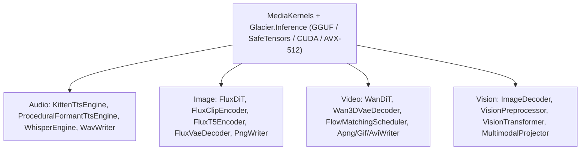

# Glacier.Media Architecture

`Glacier.Media` organizes generative audio, image, video, and vision workloads around shared tensor/SIMD kernels (`MediaKernels`) and model weight loaders provided by `Glacier.Inference`.

---

## Subsystem Overview

---

## Key Architectural Guarantees

1. **Zero External Runtime Dependencies for Containers & Formant Audio:**
   - Binary serialization (`WavWriter`, `PngWriter`, `BmpWriter`, `ApngWriter`, `GifWriter`, `AviWriter`) uses pure .NET `Stream`, `BinaryPrimitives`, and `ZLibStream` primitives for Native AOT portability.
   - `ProceduralFormantTtsEngine` and `KokoroTtsEngine` compute 24 kHz acoustics mathematically using Liljencrants-Fant glottal flow models and biquad vocal-tract filters.
2. **Pretrained Diffusion Pipelines (`FLUX.1` & `Wan 2.1`):**
   - `DiffusionGgufPipeline` and `VideoGenerationPipeline` run quantized DiT velocity predictions across `FlowMatchingScheduler` Euler trajectories, offload tensor math to NVIDIA CUDA when available (`FluxDiT.Gpu.cs`, `WanDiT.Gpu.cs`, `Wan3DVaeDecoder.Gpu.cs`), and decode VAE latents in `F32` precision.
   - Missing weight files (`ae.safetensors`, `clip_l.safetensors`, `t5xxl.gguf`, `Wan2.1-*.gguf`) fail fast with `FileNotFoundException` rather than silently substituting synthetic noise.
3. **Pure C# Distilled Neural TTS (`KittenTtsEngine`):**
   - Loads weights and style voices directly from SafeTensors and executes ALBERT encoding, dual-path text encoding, duration/F0 predictors, and HiFi-GAN decoding over AVX-512 / AVX2 intrinsics (`KittenTensorOps`).
4. **Honest Fallback Boundaries:**
   - Diagnostic flags (`IsNeural`, `SupportsModelWeights`, `SupportsLocalDecoding`, `RequiresRemoteEndpoint`, `[Experimental("GLACIER_EXP001")]`) distinguish weight-backed neural pipelines, procedural synthesizers, and HTTP client proxies.
